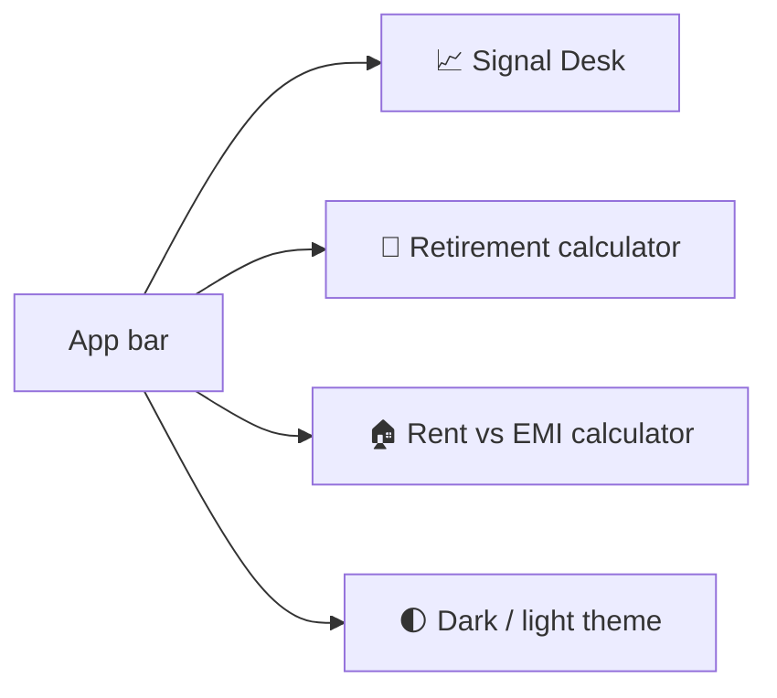
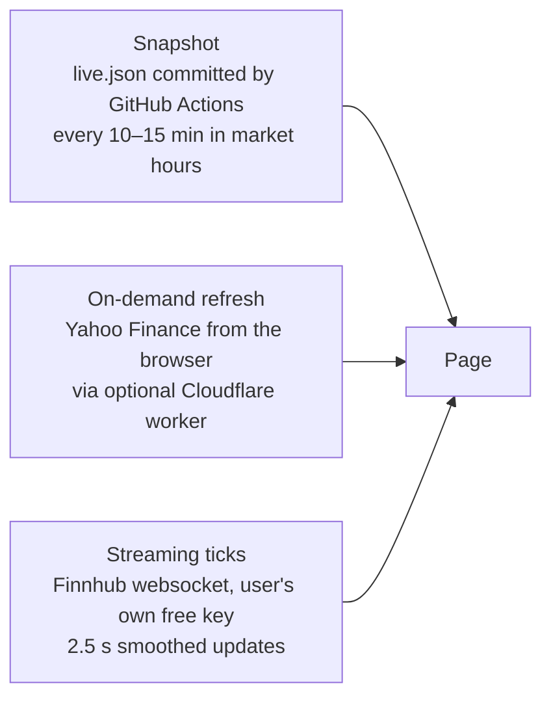
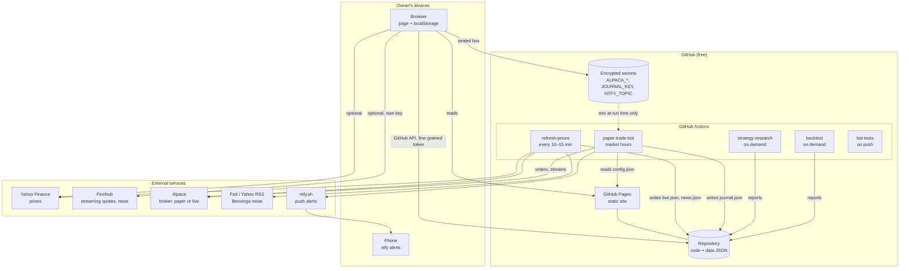
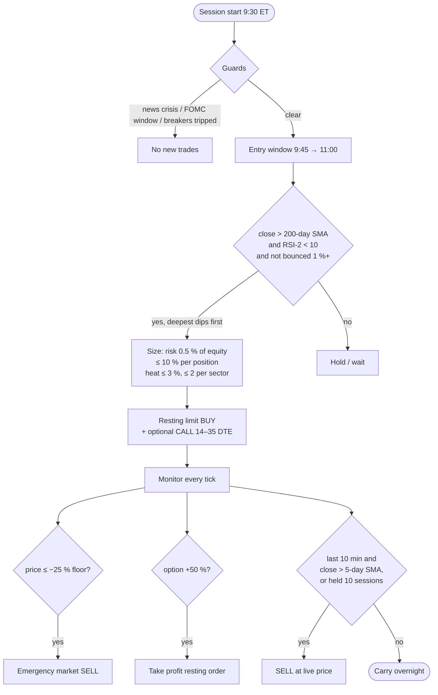
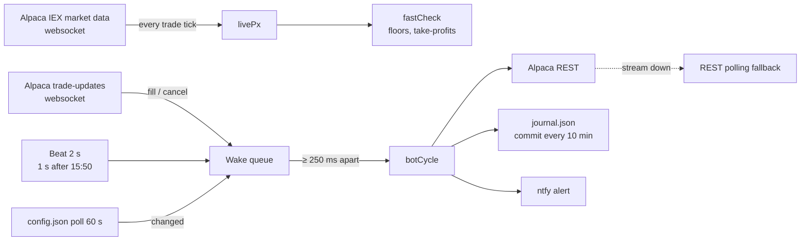
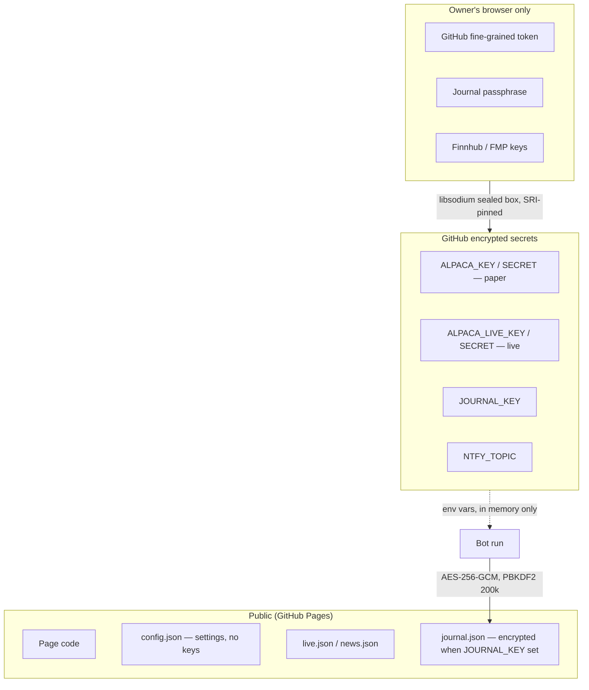

# Signal Desk — System Documentation

**Version:** 1.2 · **Last updated:** 2026-10-22 · **Status:** living document, updated with every change (see [§9](#9-change-log-and-maintenance))

Signal Desk is a personal stock-signal website with an attached rules-based trading bot.
This document is the single place that explains **what it does** (functional), **how it is
built** (architecture) and **how it works inside** (technical), so that anyone — the owner,
a family member, a developer or a future AI assistant — can understand and maintain it.

Everything in this document and in the system is **not financial advice**. The website places
no orders; the bot places orders only on a brokerage account whose keys its owner chose to give it.

---

## Table of contents
1. [What Signal Desk is](#1-what-signal-desk-is)
2. [Functional description](#2-functional-description)
3. [Architecture](#3-architecture)
4. [Technical reference](#4-technical-reference)
5. [The trading bot in depth](#5-the-trading-bot-in-depth)
6. [Security model](#6-security-model)
7. [Operations and runbook](#7-operations-and-runbook)
8. [Testing and quality](#8-testing-and-quality)
9. [Change log and maintenance](#9-change-log-and-maintenance)
10. [Glossary](#10-glossary)

---

## 1. What Signal Desk is

| Part | What it is | Where it runs | Cost |
|---|---|---|---|
| **Website** | One static HTML page with three apps: *Signal Desk* (stocks), *Retirement* calculator, *Rent vs EMI* calculator | GitHub Pages (`https://harimula.github.io/signal-desk/`) and a private copy on claude.ai | $0 |
| **Data refresh** | Fetches prices and news every 10–15 minutes during market hours, commits them to the repo | GitHub Actions | $0 |
| **Trading bot** | Event-driven rules engine trading an Alpaca account (paper by default) during US market hours | GitHub Actions | $0 |
| **Research** | 33-year backtest harness that chose the strategy, re-runnable on demand | GitHub Actions | $0 |

Design principles:
- **No servers to maintain.** Everything is static files plus scheduled GitHub Actions jobs.
- **No secrets anywhere public.** Broker keys live only in GitHub encrypted secrets; the page never sees them.
- **No vendor lock-in.** Plain Node.js (zero npm dependencies), plain HTML/JS, plain JSON data files. Nothing depends on Claude, Anthropic or any paid service.
- **Owner's data stays with the owner.** Watchlists, portfolios, keys for live quotes and calculator inputs are stored in the owner's own browser (`localStorage`); nothing is uploaded.

---

## 2. Functional description

### 2.1 The three apps



**Retirement** and **Rent vs EMI** are self-contained calculators (each an `iframe` with its own
HTML file). Inputs persist in the browser so refreshing the page never resets them. The Rent vs
EMI calculator includes a SIP (systematic investment) plan for the money left over after rent.

### 2.2 Signal Desk tabs

| Tab | Purpose | Key features |
|---|---|---|
| **USA stocks** | Signal board for ~40 US large caps + user tickers | Overview (market cards, best setups), Screener (sortable table: rating, score, price, day %, moving-average distance, analyst targets), Heat map, drill-down dialog per stock with chart, levels and an order ticket |
| **India stocks** | Same for NSE large caps | Same views, ₹ pricing, NSE hours |
| **Day trading** | Tight intraday plans | Per stock: Buy at / Sell at / Stop at, position size for a chosen amount, copy-ready order ticket, 45-day simulated record, **P/L drill-down per stock per day** |
| **Option trading** | CALL/PUT plans on the same setups | Strike/expiry suggestion, premium estimate, exit rules, daily and overall P/L like Day trading |
| **Bot trades** | Everything the bot did | Every trade with entry/exit time and P/L, daily and overall P/L, risk dashboard (heat, breakers, regime), performance vs research scorecard, live/stream indicator |
| **Bot settings** | Control panel for the bot and this device | Device sync (settings follow you, see §2.4), risk profile (Conservative/Balanced/Aggressive/Custom), capital split stocks vs options, strategy parameters, stock universe, news/event guards, paper/live mode, pause/resume/run-now, broker keys (sealed into GitHub secrets), journal passphrase |
| **News** | What is moving markets | Market brief by category, upcoming Fed/CPI/jobs schedule, tagged headlines, **news for the stocks in your portfolios** |
| **Portfolio (one tab per portfolio)** | Holdings with live P/L | Add/rename portfolios, holdings table, per-stock news |
| **My tickers** | User-added symbols | Fetched on demand, scored like the built-in universe |
| **Rules** | Every rule the page applies | Scoring table, rating bands, entry/stop/target construction |

### 2.3 Prices: three freshness levels



Price updates **morph the existing DOM** (no rebuild), so rows never jump, the scroll position
never moves, and a change shows as a brief green/red flash — like a broker app.

### 2.4 Settings follow you (device sync)

Everything the owner sets up — Finnhub/FMP keys, proxy URL, watchlist, portfolios, custom tickers, day-trade and option amounts, theme, auto-refresh choice, calculator inputs — is encrypted in the browser with the owner's passphrase (AES-256-GCM, PBKDF2-SHA256 × 200 000) and saved to the owner's own repo at `user/settings.enc.json` through the GitHub API. A new laptop or phone needs only the GitHub token and the passphrase (entered once in **Bot settings**); the rest arrives by itself. Pushes are debounced 2.5 s after any change; pulls happen on load and when the tab becomes visible again; last write wins by timestamp. The token and passphrase never sync. Rent vs EMI and Retirement inputs are included.

### 2.5 Responsive behaviour

- Desktop: full tables, ‹ › arrows beside each panel to scroll wide tables.
- Phone/tablet (touch): full-width tables, company names hidden in favour of symbols, compact header, arrows hidden (swipe instead), calculators get one scroll surface.
- Dark/light theme toggle in the app bar reaches all three apps.
- The page checks for a newer build every few minutes and reloads to it without losing scroll position or inputs.

---

## 3. Architecture

### 3.1 System context



### 3.1.1 Portability — no repo name in the code

Nothing in the code names a particular account or repository. The page works out which repo it
belongs to from the GitHub Pages address it is served from (`<owner>.github.io/<repo>/`), and the
bot from `GITHUB_REPOSITORY`, which Actions sets for the repo it is running in. A copy served from
anywhere else (the claude.ai artifact) falls back to the `FALLBACK_REPO` constant near the top of
the page script — the one line to change when the project moves. Moving to another account or
repo name is therefore a copy plus re-enabling the services: see `MIGRATION.md`.

### 3.2 Repository layout

```
signal-desk/
├── index.html              the website (built; all three apps + app bar)
├── retire.html             Retirement calculator (iframe)
├── rentemi.html            Rent vs EMI calculator (iframe)
├── live.json               price snapshot written by refresh-prices
├── news.json               news feed written by refresh-prices
├── events.json             FOMC / CPI / jobs / PPI / minutes calendar through 2027
├── symbols.json            built-in universe (US + India)
├── ver.txt                 build stamp; the page polls it to self-update
├── fetch.mjs               price fetcher (Yahoo) used by refresh-prices
├── news.mjs                news fetcher (RSS + Benzinga) used by refresh-prices
├── worker.js               optional Cloudflare worker: CORS proxy for Yahoo
├── bot/
│   ├── live.mjs            session runner: websockets, event loop, config hot-reload
│   ├── bot.mjs             decision cycle: entries, exits, floors, breakers, journal
│   ├── strategy.mjs        indicators and signals (SMA, RSI-2, exits)
│   ├── risk.mjs            sizing, heat, sector caps, regime, loss streak
│   ├── news.mjs            headline classifier, event guard, per-symbol risk
│   ├── config.mjs          presets, defaults, ranges, normalisation
│   ├── config.json         the control-panel settings (written by the page)
│   ├── journal.mjs         FIFO trade pairing from broker fills
│   ├── journal.json        trade journal (encrypted when JOURNAL_KEY is set)
│   ├── backtest.mjs        single-strategy backtest with costs and metrics
│   ├── research.mjs        4-strategy portfolio simulator, out-of-sample split
│   ├── research.json / research_report.md   research results (shown on Bot tab)
│   ├── backtest.json / backtest_report.md   backtest results
│   └── test.mjs            29 unit tests (run in CI)
├── .github/workflows/
│   ├── refresh.yml         refresh-prices
│   ├── trade.yml           paper-trade-bot
│   ├── research.yml        strategy-research
│   ├── backtest.yml        backtest
│   └── test.yml            bot-tests
├── MIGRATION.md            moving to another account or repo name
├── docs/
│   ├── ARCHITECTURE.md     this document
│   ├── index.html          the same documentation as a web page (/docs/)
│   └── architecture.pptx   architecture slides
├── BOT.md  SECURITY.md  ACCOUNTS.md  FAMILY.md  MIGRATION.md  README.md
```

### 3.3 Data flow

```mermaid
sequenceDiagram
  autonumber
  participant Y as Yahoo / RSS / Benzinga
  participant RF as refresh-prices (Actions)
  participant R as Repo / Pages
  participant P as Page (browser)
  participant B as Bot (Actions)
  participant A as Alpaca

  loop every 10–15 min, market hours
    RF->>Y: fetch daily bars, quotes, headlines
    RF->>R: commit live.json, news.json, ver.txt
  end
  P->>R: load page, live.json, news.json, bot/journal.json
  P->>P: score, rate, render; localStorage for user data
  P-->>R: (Bot settings) write bot/config.json via GitHub API
  loop every 5 min cron, one session per day
    B->>R: read bot/config.json (hot-reload every 60 s)
    B->>A: account, positions, orders, bars
    A-->>B: trade-updates + market-data websockets
    B->>A: limit orders (entries, take-profits), market exits
    B->>R: commit bot/journal.json every 10 min and at close
  end
```

### 3.4 Deployment and scheduling

| Workflow | Trigger | What it does | Limits |
|---|---|---|---|
| `refresh-prices` | cron `*/10 13-21 * * 1-5` (US) and `*/15 3-10 * * 1-5` (India), manual | `node fetch.mjs` → `live.json`; `node news.mjs` → `news.json`; commits | ~1 min |
| `paper-trade-bot` | cron `*/5 13-21 * * 1-5`, manual; `concurrency` so only one session runs | `node bot/live.mjs` for up to 345 min; exits early if `bot/STOP` exists | 358 min timeout |
| `strategy-research` | manual | `node bot/research.mjs` → `research.json`, `research_report.md` | 40 min |
| `backtest` | manual | `node bot/backtest.mjs` → `backtest.json`, `backtest_report.md` | 30 min |
| `bot-tests` | push / PR | `node bot/test.mjs` | 5 min |

All actions are pinned to exact commit SHAs (`actions/checkout@11bd719… # v4.2.2`,
`actions/setup-node@49933ea… # v4.4.0`).

---

## 4. Technical reference

### 4.1 Website

- **Stack:** one HTML file, vanilla JavaScript, no framework, no build tooling in the repo (the owner's build script fills the price snapshot into the page template). External scripts: only libsodium (for sealing secrets), loaded from jsDelivr with Subresource Integrity hashes.
- **State:** `localStorage` keys prefixed `sd-` (watchlist, portfolios, custom tickers, theme, auto-refresh choice, Finnhub/FMP keys, GitHub token, journal passphrase) plus the calculators' own keys. All of it except the token and passphrase roams between devices through `user/settings.enc.json` in the repo (§2.4); a **setup link** can still carry quote keys to a device without the token.
- **Rendering:** `renderAll(bg)`. The foreground path rebuilds a tab; the background path (price ticks) morphs the existing DOM in place (`morphEl`/`morphKids`/`morphSet`, keyed by `data-s`), preserving `<details>` open state, row order and scroll offsets. Browser scroll anchoring is disabled; an interaction guard delays updates while the user is scrolling or typing.
- **Scoring:** each stock gets a score from trend (50/200-day averages), momentum, RSI, volume, distance to the chosen moving average, analyst targets and recent signals; the score maps to Top Buy / Buy / Hold / Sell / Top Sell bands. The Rules tab documents every weight.
- **Self-update:** the page polls `ver.txt`; when a newer build appears it reloads once, keeping tab and scroll.

### 4.2 Data files

| File | Written by | Shape |
|---|---|---|
| `live.json` | `fetch.mjs` | `{ at, rows: { SYM: [px, prevClose, …] }, bars: { SYM: [...] }, stamp }` — daily bars and latest quotes for the universe |
| `news.json` | `news.mjs` | `{ at, items: [{t, h, u, sum, s}], bySym: { SYM: [...] } }` — tagged headlines, per-ticker filtered |
| `events.json` | hand-maintained | `[{ date, time, type, title }]` — FOMC, CPI, JOBS, PPI, MINUTES |
| `bot/config.json` | Bot settings tab | see §5.4 |
| `bot/journal.json` | bot | plaintext `{ at, equity, day, trades, acts, … }` or encrypted `{ enc:1, kdf, iter, salt, iv, ct, at, sig, paper, stream }` |
| `bot/research.json` | research workflow | per-strategy metrics (CAGR, Sharpe, max DD, OOS split) |
| `user/settings.enc.json` | the page (device sync) | `{ enc:1, kdf, iter, salt, iv, ct }` wrapping `{ v, at, dev, data: { key: value } }` |

### 4.3 Bot modules

| Module | Responsibility | Key exports |
|---|---|---|
| `live.mjs` | Process lifecycle for one market session; websocket subscriptions (trade updates + IEX market data); wake queue; 2 s beat (1 s after 15:50); polling fallback; config hot-reload; journal commit; stream reconnect on paper↔live switch | — |
| `bot.mjs` | One decision cycle: load bars, compute signals, apply guards, size, place/cancel orders, floors, take-profits, breakers, journal | `botCycle`, `fastCheck`, `applyConfig`, `pushPrice`, `endpoints`, `redact` |
| `strategy.mjs` | Indicators and signals | `sma`, `rsi2`, `rsi2Signal`, `rsi2Exit`, `replay` |
| `risk.mjs` | Money management | `stockQty`, `optionQty`, `regimeOf`, `lossStreak`, `openRisk`, `SECTOR` |
| `news.mjs` | Event and headline guards | `classify`, `loadEvents`, `guard`, `symbolRisk` |
| `config.mjs` | Settings schema | `PRESETS`, `DEFAULTS`, `RANGES`, `normalize`, `summary` |
| `journal.mjs` | Pair fills into round trips (FIFO) | `parseSym`, `buildJournal` |

Zero npm dependencies; Node 20+ (uses built-in `fetch`, `WebSocket`, `crypto.webcrypto`).

---

## 5. The trading bot in depth

### 5.1 Why RSI-2

`bot/research.mjs` simulated four strategies on 39 large US stocks, 1993 → 2026, with 0.05 %
costs per side, 10 % of equity per position, at most 6 positions, judged on the **last 30 % of
years (2016–2026), which were never used to choose anything**.

| Strategy | OOS CAGR | OOS Sharpe | OOS max drawdown |
|---|---|---|---|
| **RSI-2 mean reversion (chosen)** | **+16.4 %** | **1.45** | **−11.9 %** |
| Trend breakout | +7.2 % | 0.70 | −13.6 % |
| SPY buy & hold | +13.3 % | 0.79 | −34.1 % |
| Original intraday pullback rules (retired) | −4.1 % | −0.86 | −35.0 % |

Survivorship bias flatters all rows; treat them as an upper bound.

### 5.2 Rules



- **Entries:** 9:45–11:00 ET (after 10:15 on CPI/jobs days); limit orders at the broker.
- **Exits:** last 10 minutes once the close is above the 5-day average, or after 10 sessions. A 25 % hard floor is a disaster brake (fires within a second off the stream).
- **Options:** CALL nearest strike, 14–35 days to expiry, same dips; take-profit +50 % as a resting order, stop −50 %, closed 3 days before expiry. Skipped under the pattern-day-trader guard when equity < $25 000.
- **Guards:** FOMC/CPI/jobs calendar windows, live headline scan (war, White House, Fed, crisis keywords), SPY tone; daily (−3 %) and weekly (−6 %) loss caps; 3-loss streak pause; stale orders cancelled after 45 min.

### 5.3 Real-time engine



Measured in tests against a mock broker: fill → take-profit order 40 ms; crash tick → floor exit 110 ms.

### 5.4 Settings (`bot/config.json`)

| Key | Meaning | Default |
|---|---|---|
| `mode` | `paper` or `live` (live also needs live keys and a typed confirmation) | paper |
| `preset` | conservative / balanced / aggressive / custom | balanced |
| `riskPct`, `optRiskPct` | % of equity lost if a stock / option trade hits its stop | 0.5 / 0.5 |
| `maxHeat` | % of equity at risk across everything open | 3 |
| `perSector`, `maxPositions`, `maxOptions` | caps | 2 / 6 / 4 |
| `dayCap`, `weekCap`, `streak` | circuit breakers (% loss, % loss, losses in a row) | 3 / 6 / 3 |
| `stockPct`, `optPct` | max % of equity per stock position / option budget | 10 / 2 |
| `stocks`, `options` | enable each instrument | true / true |
| `rsiThreshold`, `maxHold`, `entryEnd` | strategy parameters | 10 / 10 / 11:00 |
| `optTakeProfit`, `optStop`, `holdFloor`, `staleMin` | exits | 50 / 50 / 25 / 45 |
| `newsGuard`, `eventGuard`, `alerts` | guards and alerts | true |
| `symbols` | universe | 30 US large caps |

The bot re-reads this file every 60 s from the public site, so a change in the Bot settings
tab is in force within a minute. Keys are **not** in this file.

---

## 6. Security model



- **Keys never touch the page or the repo.** The Bot settings tab seals them with GitHub's public key in the browser; only a workflow run can read them.
- **Paper and live are separate credentials.** Live trading requires `mode: live` **and** live keys **and** the typed phrase; a paper key is rejected by the live endpoint.
- **Device settings** are stored in the public repo only as an encrypted blob under the owner's passphrase; without the passphrase it is opaque.
- **Private journal:** with `JOURNAL_KEY` set, the journal is AES-256-GCM encrypted and all numbers are scrubbed from Actions logs; the page decrypts locally with the passphrase.
- **Supply chain:** the only third-party script is pinned by hash; Actions are pinned to commit SHAs; the bot has no npm dependencies.
- **Broker API keys can trade but cannot withdraw funds** (verify in your own Alpaca settings).
- **Owner checklist** (`SECURITY.md`): 2FA everywhere (no SMS), sole collaborator on the repo, token scoped to one repo with ≤ 90-day expiry, random ntfy topic, never paste keys into chat or issues.

---

## 7. Operations and runbook

### 7.1 First-time setup (≈ 20 minutes)
1. Alpaca account → Paper → generate API keys.
2. GitHub fine-grained token: only this repo; Contents, Secrets, Actions: read & write; 90-day expiry.
3. Site → **Bot settings**: connect with the token, paste Alpaca paper keys, choose a risk profile, set a journal passphrase, Save.
4. Repo → Actions → enable workflows; Settings → Actions → Workflow permissions → Read and write.
5. 2FA on GitHub, Alpaca and email.

The bot starts on the next market morning. Nothing on the owner's devices needs to stay on.

### 7.2 Day-to-day
| Need | Where |
|---|---|
| See trades, P/L, risk | Bot trades tab |
| Change risk, universe, guards | Bot settings tab → Save (in force within 60 s) |
| Pause / resume / run now | Bot settings tab buttons (writes/removes `bot/STOP`, dispatches workflow) |
| Alerts on the phone | ntfy app subscribed to the `NTFY_TOPIC` |
| Re-run research or backtest | Actions tab → workflow → Run workflow |

### 7.3 Going live
Run paper 2–3 months. Then add `ALPACA_LIVE_KEY` / `ALPACA_LIVE_SECRET`, switch Mode to Live in
Bot settings, type the confirmation. Lower the risk profile first. Mind the pattern-day-trader rule (< $25 000), real slippage, overnight gaps and taxes (`SECURITY.md`).

### 7.4 Troubleshooting
| Symptom | Check |
|---|---|
| Bot tab says "No bot activity" | Actions → paper-trade-bot → latest run log; keys present? workflow enabled? |
| "Settings save failed" | Token expired or scoped wrong; regenerate |
| Prices stale | Actions → refresh-prices runs; press ↻ Refresh prices |
| Page shows lock screen | Enter the journal passphrase (same as `JOURNAL_KEY`) |
| Settings missing on a new device | Bot settings → connect GitHub, then enter the passphrase under *Sync across devices* |
| Live quotes not moving | Finnhub key saved on this device? Market open? |

---

## 8. Testing and quality

- `bot/test.mjs`: 29 unit tests (indicators, signals, sizing, heat, regime, guards, journal pairing, config normalisation, RSS parsing). Runs in CI on every push.
- Integration tests against **mock brokers** (REST + websocket) with a fake clock, covering: duplicate-order prevention, take-profit timing, floor exits off streamed ticks, config hot-reload, paper↔live reconnect, PDT guard, encrypted journal and log redaction.
- Page checks in headless Chromium at desktop and phone widths for every tab, including scroll-position preservation during live ticks.
- Research/backtest workflows produce reproducible reports committed to the repo.

---

## 9. Change log and maintenance

**Maintenance rule:** every change to the website, the bot or the workflows updates this document, `docs/index.html` and, when the architecture changes, `docs/architecture.pptx`, **in the same commit**. The "Last updated" line at the top and the table below are part of that commit.

| Date | Change | Docs touched |
|---|---|---|
| 2026-10-22 | Moved to `harimula/signal-desk`; page fallback repo and docs re-pointed | §3.1.1 |
| 2026-10-22 | Portability: repo name derived from the Pages URL (page) and `GITHUB_REPOSITORY` (bot); MIGRATION.md added | §3.1.1 |
| 2026-10-22 | Device sync: settings, quote keys, watchlist, portfolios and calculator inputs roam between devices through an encrypted file in the repo; Rent vs EMI inputs now persist | §2.4, §4.1, §4.2, §6 |
| 2026-10-21 | Documentation set created: ARCHITECTURE.md, docs/index.html, architecture.pptx; docs link on the page | all |
| 2026-10-21 | Mobile layout: full-width tables, symbol-only column, compact header; arrows hidden on touch screens | §2.4 |
| 2026-10-21 | Security round: separate live keys, encrypted journal + redacted logs, PDT guard, SRI-pinned scripts, pinned Actions, SECURITY.md, FAMILY.md | §6 |
| 2026-10-21 | Real-time engine: trade-updates + market-data websockets, event-driven cycles, 2 s/1 s beat, polling fallback; stream indicator on Bot tab | §5.3 |
| 2026-10-21 | Bot settings control panel (config.json hot-reload, sealed secrets, pause/resume/run) | §2.2, §5.4 |
| 2026-10-21 | Strategy switched to RSI-2 after 4-strategy research; idempotent orders; 29 tests + CI | §5.1, §8 |
| 2026-10-21 | Risk engine, regime filter, pro backtest, alerts | §5.2 |
| 2026-10-21 | News tab, per-portfolio news, news/event guard, events calendar | §2.2 |
| 2026-10-21 | Bot trades tab; options (CALL/PUT) + stock trades; early take-profit; every-second monitoring | §2.2, §5 |
| 2026-10-21 | Paper-trading bot + 40-year backtest workflow | §3, §5 |
| 2026-10-21 | Day trading order tickets, P/L drill-down per stock per day; Option trading tab | §2.2 |
| 2026-10-21 | Flicker-free live prices (DOM morphing), scroll preservation, theme toggle, self-update | §2.3, §4.1 |
| 2026-10-21 | App switcher: Signal Desk / Retirement / Rent vs EMI (with SIP plan) | §2.1 |

---

## 10. Glossary

| Term | Meaning |
|---|---|
| **RSI-2** | 2-period Relative Strength Index; below 10 marks a sharp short-term dip |
| **SMA** | Simple moving average (e.g. 200-day) |
| **OOS** | Out-of-sample: years held back from strategy selection, used only to judge |
| **CAGR / Sharpe / max DD** | Yearly growth rate / return per unit of volatility / worst peak-to-trough loss |
| **Heat** | Total % of equity at risk across all open positions and pending orders |
| **Regime** | Market state (e.g. SPY above/below its 200-day) used to allow or block entries |
| **PDT** | Pattern Day Trader rule: under $25 000, max 3 same-day round trips in 5 business days |
| **DTE** | Days to expiry of an option |
| **Paper trading** | Simulated account with fake money and real prices |
| **Sealed box** | Public-key encryption (libsodium) used to store secrets in GitHub without the browser ever being able to read them back |
| **ntfy** | Free push-notification service used for bot alerts |
